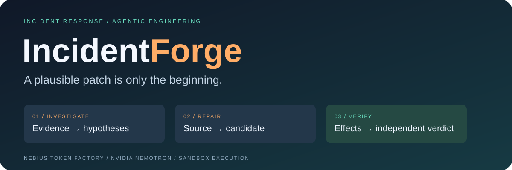
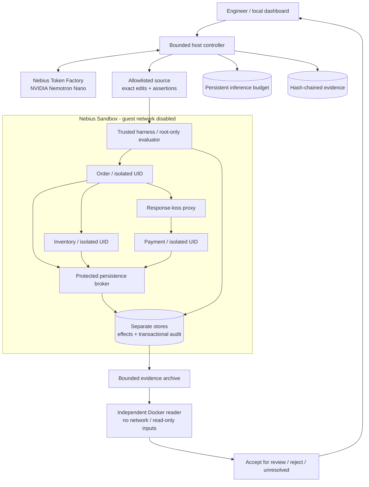
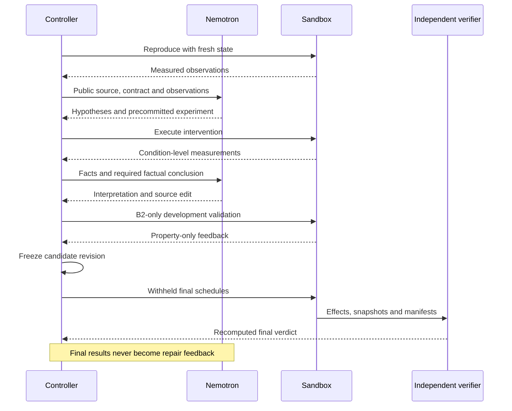

<div align="center">



**Autonomous incident investigation. Reviewable repairs. Independent behavioral evidence.**

[](pyproject.toml)
[](LICENSE)
[](docs/ARCHITECTURE.md)
[](src/incidentforge/llm.py)

[Interactive judge demo](https://ns-0437.github.io/incidentforge/) · [Quick start](#try-it) · [Architecture](#architecture) · [Experiments](#two-incidents-three-protocols) · [Results](#measured-results) · [Trust](#trust-boundaries)

</div>

---

## Why this exists

**Hosting status:** the [frontend is live on GitHub Pages](https://ns-0437.github.io/incidentforge/). It is served independently of the developer computer.

Explore the [recorded investigation desk](https://ns-0437.github.io/incidentforge/): two synthetic incidents, measured observations, proposed patches, verification results, and an interactive architecture diagram. The static demo spends no inference credits. Its development runs are separate from the completed T8 campaign and its disclosed failures. [Publishing guide](docs/JUDGE_FRONTEND.md).

A payment response disappears **after the charge commits**. A retry uses a fresh
identity. The order looks healthy—and the customer is charged twice.

IncidentForge asks a coding agent to do more than make an error disappear:
reproduce a distributed failure, compare explanations, run a controlled
experiment, edit the application, and submit a frozen patch to an evaluator
it cannot rewrite.

**The deliverable is a patch for human review, validated under declared conditions.**
Passing tests is not proof of universal correctness. A correct patch is not
proof that the model's explanation was correct, either.

> Built for the **Coding and Agentic Engineering Track** of the Nebius Global AI
> Hackathon, using real Token Factory inference and real Sandbox execution.
> Source published with owner approval on October 11, 2026.

## Follow an incident

| Step | What happens | Evidence you can inspect |
| :--- | :--- | :--- |
| **Reproduce** | Fresh stores and a witnessed failure | HTTP observations, durable effects, reset evidence |
| **Investigate** | Competing hypotheses and precommitted predictions | Source references, conditions, measured facts |
| **Repair** | Bounded edits and required passing developer assertions | Exact diff, rejected actions, candidate revision |
| **Challenge** | B2 receives property-only feedback | Violated properties, without private schedule text |
| **Verify** | Frozen candidate meets withheld schedules | Independent verdicts, hashes, boundary receipts |
| **Review** | Local dashboard presents patch and limitations | Timeline, hypothesis cards, diff, review ZIP |

<details>
<summary><b>What makes this different from an ordinary edit/test loop?</b></summary>

The evaluator checks charges, stock and compensation against protected
transactional effect history—not just HTTP status codes or agent-authored tests.
Candidate users cannot read private schedules or modify the audit. Unknown
inference usage or remote execution blocks redispatch.

Existing work such as [AIOpsLab](https://github.com/microsoft/AIOpsLab) explores
agentic incident environments and evaluation. IncidentForge's claim is the
tested combination here, not that agents have never investigated incidents or
executed tests before.

</details>

## Architecture



<details>
<summary><b>Explore the agent loop and final-evaluation boundary</b></summary>



B0 may investigate voluntarily. B1 requires investigation. B2 adds development
feedback. The final evaluator runs outside the model loop for all three.

</details>

## Two incidents, three protocols

| Incident | Failure mechanism | What a plausible bad fix misses |
| :--- | :--- | :--- |
| **IF-001 · duplicate charging** | Committed response loss; retry changes operation key | HTTP success can conceal multiple charges |
| **IF-002 · stranded compensation** | Durable intent is scheduled by a volatile process-local set | Clean decline works; restart strands stock |

| Variant | Required workflow | Protected feedback while editing |
| :--- | :--- | :---: |
| **B0** | Competent inspect / edit / test baseline | No |
| **B1** | B0 + hypotheses and controlled experiment | No |
| **B2** | B1 + behavioral feedback | Once |

All share model, source visibility, public contract, tools and resource limits.
Failed attempts remain in the denominator.

## Measured results

**T8 completed all 12 attempts: 2 accepted final repairs, 2 rejected frozen
candidates, and 8 unresolved attempts.** Four candidates received independent
final evaluation. B0 repaired IF-001 once; B2 repaired IF-002 once. Three
inference timeouts triggered the predeclared infrastructure-invalidity threshold,
so **no variant ranking is supported**. All failed attempts remain in the results.

At the close of T8, project exposure was **$0.155573 / $0.20**, including the full reservations for
three calls with unknown usage. The disclosed [continuation amendment](docs/T8_CONTINUATION.md)
preserved the frozen source and all twelve original slots.

Development and evaluator readiness are separate from that campaign:

- Reference controls passed **4/4 final schedules per family**, locally and on Sandbox.
- The same schedules rejected **5/5 authored harmful controls**.
- A prior live B2 development repair passed **8/8 protected cases twice**,
  including fresh verification after freeze. It is not a T8 comparison score.
- Factual conclusions are checked against measurements; causal prose remains unverified.

See [T8 results](docs/T8_RESULTS.md), [protocol](docs/T8_PROTOCOL.md),
[pre-T8 review](docs/PRE_T8_STATUS.md), and [curated data](benchmarks/t8/summary.json).

Post-T8 development now requires authored assertions to run and pass on the final
candidate revision. Exact edits are compiled before execution, rejected edits require
a fresh source read, and unknown inference usage remains reserved in the ledger.

| Recorded development evidence | Result | Important limitation |
| :--- | :--- | :--- |
| [IF-001 / v22](benchmarks/reliability/v22-pilot.json) | Accepted frozen repair; final authored assertion passed | The assertion also passed before repair; it does not detect duplicate charging |
| [IF-002 / v25](benchmarks/reliability/v25-pilot.json) | Restart assertion failed before repair and passed afterward; 8/8 protected cases accepted in each of two executions | One successful development run after retained failures; repeat reliability is unproven |
| [Clean checkout](benchmarks/release/rehearsal-v25.json) | 115 portable tests, 19 Linux checks with no skips, four UI routes and static package verified | Local rehearsal; funded judge access remains pending |

The judge viewer shows these two development runs, their patches and test-quality
limitations. The frozen T8 results above remain unchanged. Read the full
[development history](docs/POST_T8_RELIABILITY.md) for unsuccessful attempts.

As of October 4, accounted development exposure is **$0.337380 / $0.40**,
including conservative reservations for unknown historical usage. Remaining
allocation is **$0.062620**; there are no pending calls at this checkpoint.

## Try it

Start with the [judge guide](docs/JUDGE_GUIDE.md). The
[release checklist](docs/RELEASE_CHECKLIST.md), [submission draft](docs/DEVPOST_DRAFT.md)
and [video script](docs/VIDEO_SCRIPT.md) track the remaining handoff work.
The latest [fresh-checkout rehearsal](benchmarks/release/rehearsal-v25.json)
passed 115 portable tests, 19 Linux checks and local HTTP startup without model calls.
The [submission package](docs/SUBMISSION_PACKAGE.md) links the reviewed copy,
recording instructions, evidence and remaining release steps.

**Prerequisites:** Python 3.12+, Docker with Linux containers, and a cached
`python:3.12-slim` image. Sandbox execution also needs enabled Nebius access and an
authenticated ConTree SDK environment.

```powershell
git clone https://github.com/ns-0437/incidentforge.git
cd incidentforge
python scripts/serve-ui.py --port 8765
```

Open **http://127.0.0.1:8765**. Select an incident and variant, launch or cancel a
run, inspect hypotheses, measured observations, diffs and validation, then export
a review ZIP. Fresh clones start with empty local history; curated benchmark
results are included, while raw runs stay local.

<details>
<summary><b>Run checks without spending inference credits</b></summary>

```powershell
python -m unittest discover -s tests -t .

# Linux isolation and behavioral fixture checks
.\scripts\run-t0-linux.ps1 -Stage t6
```

Add `-PullImage` if the base image is missing. Each execution pins its resolved
image ID. Containers and volumes are removed by exact ID, never global prune.
Windows-only tests do not establish Linux boundary protection.

</details>

<details>
<summary><b>Run a live investigation on Nebius Sandbox</b></summary>

Authenticate ConTree with your own Token Factory key and project ID. Keep those
in its profile or environment, never in this repository. Set `CONTREE_PYTHON`
to the Python executable in your ConTree environment when it differs from the
default Windows location.

```powershell
python scripts/run-t4.py --live --variant B2 --incident IF-002 --backend contree
```

The owner-approved cumulative inference ceiling is **$0.40** for this development
project (new ledgers default to $0.20); it is not a promise that
inference is free. Sandbox beta execution was confirmed free for the development
account; confirm your account terms. Docker is still needed to independently
verify exported remote evidence. Sandbox startup checks the Linux engine and
pins the reader image before any model calls.

The local UI offers Docker or Nebius Sandbox; the command above selects Sandbox.
Both use the same controller. The public Pages demo is a recorded replay; there is no hosted
public inference service.

</details>

<details>
<summary><b>Reproduce the comparison protocol</b></summary>

```powershell
# Authored controls only: no model calls
python scripts/check-t8-schedules.py
python scripts/check-t8-remote.py

# New campaign name required; live execution consumes inference credits
python scripts/run-t8.py my-campaign --freeze
python scripts/run-t8.py my-campaign
```

Never modify frozen source during a campaign. Stopped campaigns have no automatic
resume or retry. Reconcile unknown usage first; do not delete the reservation or
start a fresh budget database to bypass the guard. Completed wall-time failures
can use the audited [conservative reconciliation tool](docs/TIMEOUT_RECOVERY.md);
full unknown reservations remain counted.

</details>

## Trust boundaries

| Boundary | Enforcement |
| :--- | :--- |
| Private schedules, evaluator, Git history | Candidate allowlist and root-only harness paths |
| Canonical effects and audit | Broker authorization and transactional triggers |
| Other service stores | Separate UIDs and authenticated Unix sockets |
| Host credentials and guest network | Host-only credentials; guest egress disabled |
| Costs and retries | Persistent reservations, caps and unknown-state guards |
| Frozen patch | Revision hashes and independently checked exports |

This is selected tested coverage, not proof against every malicious program or
kernel exploit. See [SECURITY.md](SECURITY.md).

## Explore the code

```text
src/incidentforge/    Controller, model, evidence, budget, backends, UI
fixture/app/         Order, Inventory and Payment application
fixture/harness/     Trusted orchestration, isolation and persistence
evaluation/          Protected verifier, controls and withheld schedules
contracts/public/    Business contract visible to the agent
probes/              Bounded runners and archive verification
tests/               Controller, isolation and behavioral tests
scripts/             Operator entry points and campaign drivers
benchmarks/t8/       Curated freeze and results; no raw prompts or databases
docs/                Original brief, design, protocol and stage reviews
```

<details>
<summary><b>Limitations and next steps</b></summary>

- Two synthetic defect implementations; final tests vary schedules, not defect classes.
- T8 recorded all twelve attempts, but three infrastructure failures invalidate ranking. No superiority or statistical-significance claim.
- Causal reasoning remains a model claim even when a repair passes.
- IF-002 restarts Inventory as well as Order to discard old queued requests.
- Local operator console, not a production multi-user platform.
- Judge access, video and submission packaging are T9 work. Trial credits are not
  assumed to last through judging.

The [original brief](docs/ORIGINAL_BRIEF.md) remains the scope authority.
Historical stage documents describe their checkpoint; the latest result report
takes precedence for status.

</details>

---

Built by **Navin Kumar** · [MIT license](LICENSE) · [Contributing](CONTRIBUTING.md)

*Initial commits import real milestones at their actual import time. They are
not backdated development history.*
